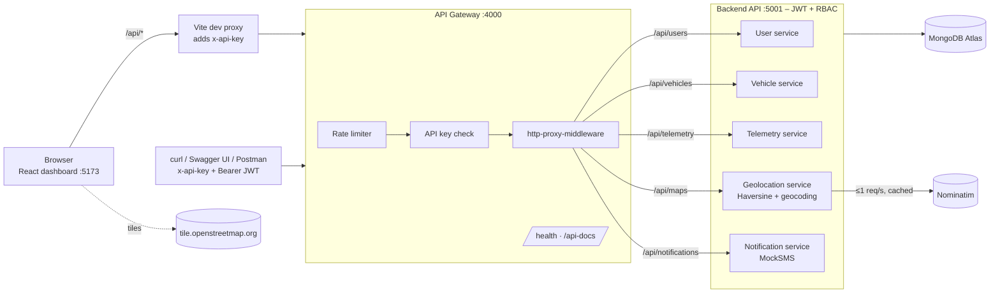

# FleetOps – Fleet Management System

A full-stack fleet management platform: a React dashboard, an Express API Gateway, and a Node.js/MongoDB backend
composed of five services (users, vehicles, telemetry, geolocation, notifications). It runs entirely locally —
no paid mapping service, no real SMS provider, and no GPS hardware are required.

## Contents
1. [Features](#1-main-features) · 2. [Technology stack](#2-technology-stack) · 3. [Architecture](#3-architecture) · 4. [Folder structure](#4-folder-structure)
5. [Prerequisites](#5-prerequisites) · 6. [Installation](#6-installation) · 7. [MongoDB Atlas](#7-mongodb-atlas-configuration) · 8. [Environment variables](#8-environment-variables)
9. [Seeding](#9-database-seeding) · 10. [Running](#10-running-the-application) · 11. [Nominatim](#11-openstreetmap-nominatim-geocoding) · 12. [Leaflet map](#12-leaflet-map-integration)
13. [MockSMS](#13-mocksms-architecture) · 14. [JWT & RBAC](#14-jwt-authentication-and-rbac) · 15. [API Gateway](#15-api-gateway) · 16. [Swagger](#16-swagger--openapi) · 17. [Testing](#17-automated-testing)
18. [Example API calls](#18-example-api-calls) · 19. [Known limitations](#19-known-limitations)

See also **[documentation/DEMO_GUIDE.md](documentation/DEMO_GUIDE.md)** for a step-by-step demonstration script and **[screenshots/](screenshots/README.md)** for captures of the required demonstrations.

> **Deployment:** this application has **not** been deployed – there is no deployed application/API link. It runs locally as described in [Running the application](#10-running-the-application).

## 1. Main features

- **Authentication & RBAC** – JWT login; `admin`, `fleet_manager`, `viewer` roles enforced by the backend and reflected in the UI.
- **Vehicle management** – register, edit, view, search by registration number, filter by status, delete (admin only).
- **Telemetry** – GPS, speed, battery and engine temperature; vehicle location is updated on every reading; critical events are auto-detected.
- **Live map** – Leaflet + OpenStreetMap tiles, colour-coded markers by status, popups, vehicle info panel, 30 s auto-refresh.
- **Nearby search** – backend Haversine search by latitude / longitude / radius; the UI shows the server-computed distance.
- **Geocoding** – address → coordinates via OpenStreetMap Nominatim, cached and rate-limited, saved to the vehicle.
- **MockSMS notifications** – engine fault / low battery / emergency stop / status change alerts with `sent` / `failed` outcomes stored in MongoDB.
- **API Gateway** – single entry point with API-key auth, rate limiting, proxying, health check and Swagger UI.
- **Automated tests** – Mocha, Chai, Supertest and Sinon (43 tests) against an isolated test database.

## 2. Technology stack

| Layer | Technology |
|---|---|
| Frontend | React 18, Vite 5, Tailwind CSS 3, React Router 6, Axios, **Leaflet 1.9 + React-Leaflet 4.2**, Lucide React |
| Gateway | Express 5, `http-proxy-middleware`, `express-rate-limit`, `swagger-jsdoc`, `swagger-ui-express`, helmet, cors, morgan |
| Backend | Node.js, Express 5, Mongoose, `jsonwebtoken`, `bcryptjs`, axios |
| Database | MongoDB Atlas |
| Geocoding | OpenStreetMap Nominatim |
| Maps | OpenStreetMap raster tiles |
| SMS | Custom MockSMS provider |
| Tests | Mocha, Chai 4, Supertest, Sinon |

## 3. Architecture



**Design decisions**

- **Modular monolith backend.** The five services are separate route + service modules sharing one Mongoose connection. Splitting them into five processes would only duplicate models and auth code, so they run in one process; the gateway still routes each prefix through its own configurable URL (`USER_SERVICE_URL` …), so any service can be extracted later with no gateway code change.
- **Backend on port 5001, not 5000.** macOS's AirPlay Receiver occupies port 5000 and answers `403` to everything.
- **The API key stays out of the browser.** The Vite dev server proxies `/api` to the gateway and attaches `x-api-key` server-side from the root `.env`. The key is never in the JS bundle (verified by searching the build output). For a production build you would put a reverse proxy in the same role.
- **Frontend → gateway → backend only.** The UI never calls the backend directly.

## 4. Folder structure

```
.
├── README.md  .env.example  .gitignore  package.json  .mocharc.js
├── documentation/                API reference, OpenAPI export, architecture, setup/testing, demo guide
├── project-report/               Project report (PDF + HTML) with embedded screenshots
├── screenshots/                  real screenshots of the required demonstrations
├── gateway/                      API Gateway (port 4000)
│   ├── gateway.js                health, docs, rate limit → API key → body parse → proxies
│   ├── config/services.js        route prefix → service URL
│   ├── middleware/               apiKey, rateLimiter, proxy, gatewayErrorHandler
│   └── docs/swagger.js           OpenAPI 3 spec (swagger-jsdoc)
├── src/                          Backend (port 5001)
│   ├── app.js                    Express app (no listen/DB connect – used by tests)
│   ├── server.js                 connects MongoDB and listens
│   ├── config/  middleware/  models/  routes/  utils/  seed/
│   └── services/
│       ├── userService  vehicleService  telemetryService  notificationService (MockSMS)
│       ├── geolocationService.js    save coordinates + Haversine nearby search
│       └── geocoding/               provider switch + cache; Nominatim client (queue, 429, timeout)
├── test/                         Mocha suites + helpers (env, hooks, factories)
└── frontend/                     React + Vite + Tailwind dashboard (port 5173)
    ├── vite.config.js            dev proxy → gateway (+ x-api-key)
    └── src/ api/  context/  components/  lib/  pages/
```

## 5. Prerequisites

- Node.js 18+ (developed on Node 26) and npm
- A MongoDB Atlas cluster (free tier is fine)
- Internet access for map tiles and Nominatim (the app is otherwise self-contained)

## 6. Installation

```bash
npm run install:all          # backend + gateway + test deps, then frontend deps
cp .env.example .env         # then edit – see below
```

## 7. MongoDB Atlas configuration

1. Create a free cluster at <https://cloud.mongodb.com>.
2. *Database Access* → add a user with read/write access.
3. *Network Access* → allow your current IP (or `0.0.0.0/0` for a short-lived demo only).
4. *Connect → Drivers* → copy the connection string into `MONGODB_URI`, including a database name:
   `mongodb+srv://<user>:<password>@<cluster>.mongodb.net/fleetdb?retryWrites=true&w=majority`

Collections (`users`, `vehicles`, `telemetries`, `notifications`, `geocodecaches`) are created automatically.

## 8. Environment variables

Copy `.env.example` to `.env`. **`.env` is git-ignored – never commit real credentials.**

| Variable | Default | Purpose |
|---|---|---|
| `PORT` | `5001` | Backend port |
| `MONGODB_URI` | – | Atlas connection string |
| `JWT_SECRET`, `JWT_EXPIRES_IN` | –, `24h` | JWT signing (use a long random secret) |
| `ADMIN_PHONE` | `+919999999999` | MockSMS alert recipient |
| `GEOCODING_PROVIDER` | `nominatim` | Geocoder implementation |
| `NOMINATIM_BASE_URL` | public Nominatim `/search` | Point to a self-hosted instance for heavy use |
| `NOMINATIM_USER_AGENT` | generic | **Identify your app + contact email** (usage-policy requirement) |
| `NOMINATIM_TIMEOUT_MS` | `8000` | Per-request timeout |
| `NOMINATIM_MIN_INTERVAL_MS` | `1100` | Minimum gap between Nominatim requests |
| `GATEWAY_PORT` | `4000` | Gateway port |
| `GATEWAY_API_KEY` | – | Secret required in `x-api-key` (also used by the Vite proxy) |
| `GATEWAY_PROXY_TIMEOUT_MS` | `10000` | Upstream timeout → 504 |
| `RATE_LIMIT_WINDOW_MS`, `RATE_LIMIT_MAX` | `900000`, `200` | Per-IP limit on `/api/*` |
| `AUTH_RATE_LIMIT_WINDOW_MS`, `AUTH_RATE_LIMIT_MAX` | `900000`, `30` | Stricter limit on login/register |
| `USER_SERVICE_URL` … `NOTIFICATION_SERVICE_URL` | `http://localhost:5001` | Upstream for each service |
| `GATEWAY_URL` | `http://localhost:4000` | Where the Vite proxy sends `/api` |
| `MONGODB_TEST_URI` | derived | Test database (see [Testing](#17-automated-testing)) |

Generate secrets with e.g. `node -e "console.log(require('crypto').randomBytes(32).toString('hex'))"`.

## 9. Database seeding

```bash
npm run seed
```

> ⚠️ This **deletes** all users, vehicles, telemetry and notifications in `MONGODB_URI`'s database, then inserts
> 3 users, 12 vehicles around Chhattisgarh, 12 telemetry records and 3 notifications.

| Role | Email | Password |
|---|---|---|
| admin | `admin@fleet.com` | `admin123` |
| fleet_manager | `manager@fleet.com` | `manager123` |
| viewer | `viewer@fleet.com` | `viewer123` |

These are demo credentials only – change them (or don't seed) for anything beyond local use.

## 10. Running the application

Three terminals, in this order:

```bash
npm start            # 1. Backend  → http://localhost:5001
npm run gateway      # 2. Gateway  → http://localhost:4000   (Swagger: /api-docs)
npm run frontend     # 3. Frontend → http://localhost:5173
```

Open <http://localhost:5173> and sign in with a seeded account. If the Vite server is started before `.env` is
populated, restart it so it re-reads `GATEWAY_API_KEY`.

## 11. OpenStreetMap Nominatim geocoding

`POST /api/maps/geocode` and `POST /api/maps/geocode/:vehicleId` call the Nominatim Search API
(<https://nominatim.org/release-docs/latest/api/Search/>) with `format=jsonv2&limit=1`.

**Usage-policy safeguards** (public instance: max 1 request/second, no bulk geocoding, identify your app):

- All lookups run through a **single serialised queue** spaced ≥ 1.1 s – never concurrent.
- **Caching** in memory and MongoDB (`geocodecaches`, 30-day TTL); normalised keys (case/whitespace) avoid repeats, and identical concurrent requests share one upstream call. Responses carry `cached: true/false`.
- A descriptive **User-Agent** from `NOMINATIM_USER_AGENT`.
- **HTTP 429/403** → honours `Retry-After`, stops calling Nominatim until it expires, returns 429 to the caller.
- **Failures** → no match 404 `ADDRESS_NOT_FOUND`; timeout 504 `GEOCODER_TIMEOUT`; unreachable/unexpected 502; coordinates outside ±90/±180 → 502 `GEOCODER_INVALID_COORDINATES`.
- The vehicle is checked **before** geocoding so an unknown ID never costs a request.
- The nearby search and GPS telemetry **do not use Nominatim** at all.

**Attribution:** Geocoding and map data © [OpenStreetMap contributors](https://www.openstreetmap.org/copyright) (ODbL). Every geocode response includes an `attribution` string, and the UI shows the attribution on the map and in the footer. The public Nominatim server is for light, interactive use only; heavy use requires a self-hosted instance (`NOMINATIM_BASE_URL`).

## 12. Leaflet map integration

`frontend/src/pages/MapPage.jsx` uses **Leaflet 1.9.4 with React-Leaflet 4.2.1** (the stable 1.x line – no Leaflet 2.0 APIs).

- Tiles: `https://{s}.tile.openstreetmap.org/{z}/{x}/{y}.png` with the required attribution control. Per the OSM tile policy, this is for development/light use; use a tile provider for production traffic.
- Markers are `L.divIcon` pins coloured by status (green active, amber idle, blue maintenance, grey inactive), which also avoids the default-marker-icon bundler problem.
- Popups show registration, status, type, coordinates and address; clicking a marker/list item fills the info panel.
- Nearby search calls `GET /api/maps/nearby`; the distance shown is exactly what the backend's Haversine returned (the frontend computes none). The circle is a visual aid only.
- Markers refresh every 30 s (toggleable) to stay inside the gateway rate limit.

## 13. MockSMS architecture

`notificationService.js` simulates an SMS gateway: `mockSMSSend` logs `[MockSMS] TO … | MSG …` to the backend console and **fails randomly ~15% of the time** to exercise error handling. Each attempt is stored in the `notifications` collection with `provider: "MockSMS"`, `status: sent|failed` and `failureReason`.

Triggers: telemetry with `ENGINE_FAULT`, `LOW_BATTERY` or `EMERGENCY_STOP` (explicit, or auto-detected: engine > 110 °C, battery < 20%), and vehicle status changes (`STATUS_CHANGE`). Delivery is fire-and-forget so API calls are not slowed by SMS. Recipient: `ADMIN_PHONE`. No real SMS is ever sent.

## 14. JWT authentication and RBAC

`POST /api/users/login` returns a JWT (payload: user id; signed with `JWT_SECRET`; expiry `JWT_EXPIRES_IN`). Protected routes need `Authorization: Bearer <token>`; the middleware verifies the signature/expiry and loads the user.

| Capability | admin | fleet_manager | viewer |
|---|:-:|:-:|:-:|
| View vehicles, telemetry, map, nearby, per-vehicle notifications | ✔ | ✔ | ✔ |
| Register / edit vehicles, change status | ✔ | ✔ | – |
| Submit telemetry, geocode addresses | ✔ | ✔ | – |
| View all notifications | ✔ | ✔ | – |
| Delete vehicles; list/create/edit/delete users; test SMS | ✔ | – | – |

In the UI, navigation and action buttons are hidden by role, the **Users** page shows an "Access restricted" screen to non-admins, and an expired/invalid token signs the user out. The backend remains the authority (403 for forbidden roles).

## 15. API Gateway

`/api/users`, `/api/vehicles`, `/api/telemetry`, `/api/maps`, `/api/notifications` are proxied (http-proxy-middleware) to the configured service URL. Request order: **rate limiter → API-key check → JSON parsing → proxy**. `/health`, `/api-docs` and `/api-docs.json` are public.

**API key** – every `/api/*` request needs `x-api-key: <GATEWAY_API_KEY>`; missing/invalid → 401 (`MISSING_API_KEY` / `INVALID_API_KEY`). Comparison is constant-time, the key is stripped before forwarding and never logged or echoed.

**Rate limiting** – `express-rate-limit`: `RATE_LIMIT_MAX` requests per `RATE_LIMIT_WINDOW_MS` per IP (default 200 / 15 min), stricter for login/register (30 / 15 min). Exceeding it returns 429 `RATE_LIMIT_EXCEEDED` with `RateLimit-*` and `Retry-After` headers. The limiter is in memory (resets on restart, not shared between instances); behind a reverse proxy configure `trust proxy`. The dashboard's polling is deliberately light (map refresh 30 s) to stay within the default.

| Situation | Status | `error` |
|---|---|---|
| Missing / wrong API key | 401 | `MISSING_API_KEY` / `INVALID_API_KEY` |
| Malformed JSON | 400 | `MALFORMED_JSON` |
| Rate limit | 429 | `RATE_LIMIT_EXCEEDED` |
| Service down / timeout | 503 / 504 | `SERVICE_UNAVAILABLE` / `GATEWAY_TIMEOUT` |
| JWT problems / forbidden role | 401 / 403 | from backend |

`GET /health` reports gateway status and each service's status/latency (503 if any is down) without exposing URLs or secrets.

## 16. Swagger / OpenAPI

Swagger UI: **<http://localhost:4000/api-docs>** · OpenAPI JSON: <http://localhost:4000/api-docs.json>
(21 paths / 26 operations, 17 schemas, two security schemes: `ApiKeyAuth` header `x-api-key` and `BearerAuth` JWT). Click **Authorize**, enter the API key, call `POST /api/users/login`, paste the token under `BearerAuth`, then use *Try it out*.

## 17. Automated testing

```bash
npm test             # run everything once
npm run test:watch   # re-run on changes
```

| File | Covers |
|---|---|
| `auth.test.js` | Test 1 – valid/invalid login, JWT generation, valid/invalid/expired tokens |
| `vehicle.test.js` | Test 2 – register, DB storage, retrieval, search/filter, 404/409/400 |
| `telemetry.test.js` | Test 3 – telemetry record, GPS coordinates, vehicle location update, history/recent |
| `notification.test.js` | Test 4 – status change → notification saved, `sent`/`failed` (deterministic via Sinon), auto-detected events |
| `rbac.test.js` | Test 5 – viewer delete → 403, admin delete allowed |
| `nearby.test.js` | Test 6 – inside/outside radius, computed distances, no network used |
| `gateway.test.js` | Test 7 – API key, forwarding, 401, malformed JSON, health, Swagger, 429 + headers, 503 |
| `geocoding.test.js` | Test 8 – mocked Nominatim: success, not found, timeout, 429 back-off, validation, memory + DB cache, serialisation |

Rules: no real Nominatim or SMS calls (axios and `Math.random` are stubbed with Sinon); no Google dependency; a **separate database** (`MONGODB_TEST_URI`, or the main URI with `_test` appended to the database name – the suite refuses to run unless the name contains `test` and differs from the main database); every test starts with empty collections and the database is dropped afterwards, so tests are repeatable and order-independent. Frontend tests are not included.

## 18. Example API calls

```bash
export GW=http://localhost:4000
export KEY=<your GATEWAY_API_KEY>
```

```bash
# 1. Login (API key only)  → export TOKEN=<data.token>
curl -s $GW/api/users/login -H "x-api-key: $KEY" -H 'Content-Type: application/json' \
  -d '{"email":"admin@fleet.com","password":"admin123"}'
# (manager token for step 11:  manager@fleet.com / manager123 → MGR_TOKEN)

# 2. Register a vehicle
curl -s $GW/api/vehicles -H "x-api-key: $KEY" -H "Authorization: Bearer $TOKEN" -H 'Content-Type: application/json' \
  -d '{"vehicleId":"VH100","registrationNumber":"CG04ZZ1234","vehicleType":"van","model":"Transit","manufacturer":"Ford"}'

# 3. All vehicles (?status=active&type=truck optional)      4. One vehicle
curl -s $GW/api/vehicles       -H "x-api-key: $KEY" -H "Authorization: Bearer $TOKEN"
curl -s $GW/api/vehicles/VH100 -H "x-api-key: $KEY" -H "Authorization: Bearer $TOKEN"

# 5. Submit telemetry (engine > 110 → ENGINE_FAULT + MockSMS; updates vehicle location)
curl -s $GW/api/telemetry -H "x-api-key: $KEY" -H "Authorization: Bearer $TOKEN" -H 'Content-Type: application/json' \
  -d '{"vehicleId":"VH100","latitude":21.2514,"longitude":81.6296,"speed":65,"engineTemperature":120,"batteryLevel":80}'

# 6. Update operational status
curl -s -X PATCH $GW/api/vehicles/VH100/status -H "x-api-key: $KEY" -H "Authorization: Bearer $TOKEN" \
  -H 'Content-Type: application/json' -d '{"operationalStatus":"maintenance"}'

# 7. Geocode (Nominatim)          8. Geocode and save to a vehicle
curl -s $GW/api/maps/geocode -H "x-api-key: $KEY" -H "Authorization: Bearer $TOKEN" -H 'Content-Type: application/json' \
  -d '{"address":"Raipur Railway Station, Chhattisgarh, India"}'
curl -s $GW/api/maps/geocode/VH100 -H "x-api-key: $KEY" -H "Authorization: Bearer $TOKEN" -H 'Content-Type: application/json' \
  -d '{"address":"Raipur Railway Station, Chhattisgarh, India"}'

# 9. Nearby vehicles (radius in km, distance from backend Haversine)
curl -s "$GW/api/maps/nearby?latitude=21.2514&longitude=81.6296&radius=50" -H "x-api-key: $KEY" -H "Authorization: Bearer $TOKEN"

# 10. Notification history
curl -s $GW/api/notifications              -H "x-api-key: $KEY" -H "Authorization: Bearer $TOKEN"   # admin / fleet_manager
curl -s $GW/api/notifications/vehicle/VH100 -H "x-api-key: $KEY" -H "Authorization: Bearer $TOKEN"  # any role

# 11. Admin-only deletion: manager → 403, admin → 200
curl -s -X DELETE $GW/api/vehicles/VH100 -H "x-api-key: $KEY" -H "Authorization: Bearer $MGR_TOKEN"
curl -s -X DELETE $GW/api/vehicles/VH100 -H "x-api-key: $KEY" -H "Authorization: Bearer $TOKEN"

# 12. Invalid API key → 401
curl -s -i $GW/api/vehicles -H "x-api-key: wrong"

# 13. Rate limit (start the gateway with a low limit: RATE_LIMIT_MAX=5 npm run gateway) → 429
for i in $(seq 1 8); do curl -s -o /dev/null -w "%{http_code} " $GW/api/vehicles -H "x-api-key: wrong"; done
```

## 19. Known limitations

- **Self-registration role**: `POST /api/users/register` accepts a `role` field, so anyone with the API key can create an admin. Acceptable for a local academic demo; restrict before any real use.
- **JWT in `localStorage`** (convenient, but exposed to XSS) and no refresh tokens or logout revocation.
- **The gateway key is a shared secret**, not per-user auth; the dashboard relies on the Vite dev/preview proxy to attach it. A production deployment needs an equivalent reverse proxy.
- **Rate-limit state is in memory** (single gateway instance).
- **Public Nominatim and OSM tile servers** are for light use only; the geocoder is serialised (≈1 s per uncached lookup).
- **MockSMS fails ~15% of the time by design**; fire-and-forget delivery has no retry.
- **Map "live" updates are polling** (30 s), not WebSockets. There is no map-wide telemetry stream.
- The backend is a **single process**; MongoDB indexes/pagination are minimal (lists are unpaginated).
- The frontend has **no automated tests** (out of scope). It was verified by running it in a headless browser (screenshots in `screenshots/`) and through its API calls.
- Port 5000 is avoided because of macOS AirPlay; adjust if your environment differs.
- Mongoose prints a `new` option deprecation warning from existing code (harmless).
