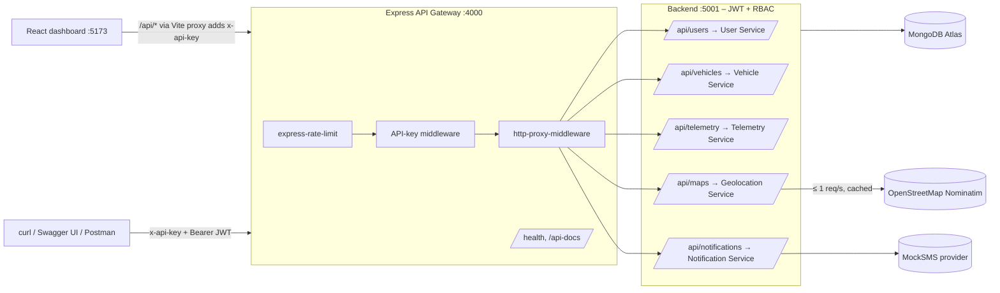

# Architecture and Design

## 1. Overview

| Component | Responsibility | Code |
|---|---|---|
| API Gateway | single entry point, API-key check, rate limiting, routing, health, Swagger UI | `gateway/` |
| User Service | register, login (JWT), user CRUD (admin) | `src/routes/userRoutes.js`, `src/services/userService.js` |
| Vehicle Service | vehicle CRUD, search, operational status (+ notification trigger) | `vehicleRoutes.js`, `vehicleService.js` |
| Telemetry Service | store GPS/telemetry, update vehicle location, detect critical events | `telemetryRoutes.js`, `telemetryService.js` |
| Geolocation Service | geocoding (Nominatim), save coordinates, Haversine nearby search | `mapsRoutes.js`, `geolocationService.js`, `services/geocoding/` |
| Notification Service | MockSMS provider, sent/failed records, history | `notificationRoutes.js`, `notificationService.js` |

**Why a modular monolith?** The services already had clean route/service boundaries and share models and the auth middleware. Separate processes would only duplicate code. The gateway still resolves every prefix through its own URL (`USER_SERVICE_URL`, `VEHICLE_SERVICE_URL`, …), so a service can be moved into its own process without changing gateway code.

**Request path:** Gateway: rate limit → API key → JSON parse → proxy. Backend: JWT authentication → role authorization → service → MongoDB.

## 2. Data model (MongoDB / Mongoose)

| Collection | Key fields |
|---|---|
| `users` | `name`, `email` (unique), `password` (bcrypt hash, never returned), `phone`, `role` ∈ admin / fleet_manager / viewer |
| `vehicles` | `vehicleId` (unique), `registrationNumber` (unique, upper-cased), `vehicleType`, `model`, `manufacturer`, `assignedDriver`, `operationalStatus` ∈ active / idle / maintenance / inactive, `address`, `location.latitude/longitude`, `batteryLevel` |
| `telemetries` | `vehicleId`, `latitude`, `longitude`, `speed`, `engineTemperature`, `batteryLevel`, `eventType` ∈ NORMAL / ENGINE_FAULT / LOW_BATTERY / EMERGENCY_STOP, `timestamp` |
| `notifications` | `vehicleId`, `recipient`, `message`, `eventType`, `provider` (MockSMS), `status` ∈ sent / failed, `failureReason`, `timestamp` |
| `geocodecaches` | normalised address key, provider, coordinates, formatted address; 30-day TTL |

## 3. Third-party integrations

### 3.1 Geolocation – OpenStreetMap
- **Address → coordinates:** Nominatim Search API (`format=jsonv2&limit=1`) through `src/services/geocoding/`. The provider is selected by `GEOCODING_PROVIDER`. Google Maps is not used.
- **Usage-policy safeguards:** one serialised request queue (≥ 1.1 s spacing, never concurrent); memory + MongoDB cache with address normalisation and in-flight de-duplication; descriptive `User-Agent`; HTTP 429/403 honours `Retry-After` and pauses all upstream calls; timeouts and invalid coordinates rejected; no bulk geocoding.
- **GPS storage:** `POST /api/telemetry` stores the reading and updates the vehicle's `location`.
- **Nearby search:** `GET /api/maps/nearby` filters vehicles with the Haversine great-circle formula (`src/utils/haversine.js`, Earth radius 6371 km). It uses stored coordinates only and never calls Nominatim.
- **Map UI:** Leaflet 1.9 + React-Leaflet 4.2 with OpenStreetMap tiles and attribution.

### 3.2 SMS – MockSMS
- `notificationService.js` simulates an SMS gateway. It logs `[MockSMS] TO … | MSG …` and fails randomly about 15% of the time so error handling can be exercised.
- Each attempt is stored with `status` sent/failed and `failureReason`.
- **Triggers:** ENGINE_FAULT, LOW_BATTERY and EMERGENCY_STOP from telemetry (explicit or auto-detected: engine > 110 °C, battery < 20%), and vehicle status changes (STATUS_CHANGE). Recipient: `ADMIN_PHONE`. Delivery is fire-and-forget.

## 4. Security model

| Layer | Mechanism | Failure |
|---|---|---|
| Gateway authentication | `x-api-key` compared in constant time to `GATEWAY_API_KEY`; stripped before forwarding; never logged or echoed | 401 |
| Rate limiting | `express-rate-limit`, per IP, configurable window/max, stricter on login/register; runs **before** the key check | 429 + `RateLimit-*` |
| Backend authentication | JWT (`jsonwebtoken`, `JWT_SECRET`, expiry `JWT_EXPIRES_IN`) | 401 |
| Backend authorization | role checks (RBAC) | 403 |
| Passwords | bcrypt (cost 12), excluded from responses | – |
| Browser | the Vite proxy attaches the gateway key server-side, so it is not in the JS bundle | – |

| Capability | admin | fleet_manager | viewer |
|---|:-:|:-:|:-:|
| Read vehicles, telemetry, map, nearby, per-vehicle notifications | ✔ | ✔ | ✔ |
| Register / edit vehicles, change status, submit telemetry, geocode | ✔ | ✔ | – |
| View all notifications | ✔ | ✔ | – |
| Delete vehicles, manage users, test SMS | ✔ | – | – |

## 5. Error handling (gateway)

Invalid API key 401 · malformed JSON 400 · rate limit 429 · service unreachable 503 · proxy timeout 504 · unexpected 500. Backend 401 (JWT), 403 (role), 400/404/409 pass through unchanged.

## 6. Design trade-offs
- **Port 5001** instead of 5000 (macOS AirPlay Receiver occupies 5000).
- **In-memory rate limiting** is simple and adequate for one gateway instance; multiple instances would need a shared store such as Redis.
- **Polling (30 s)** for the live map instead of WebSockets, to stay simple and inside the rate limit.
