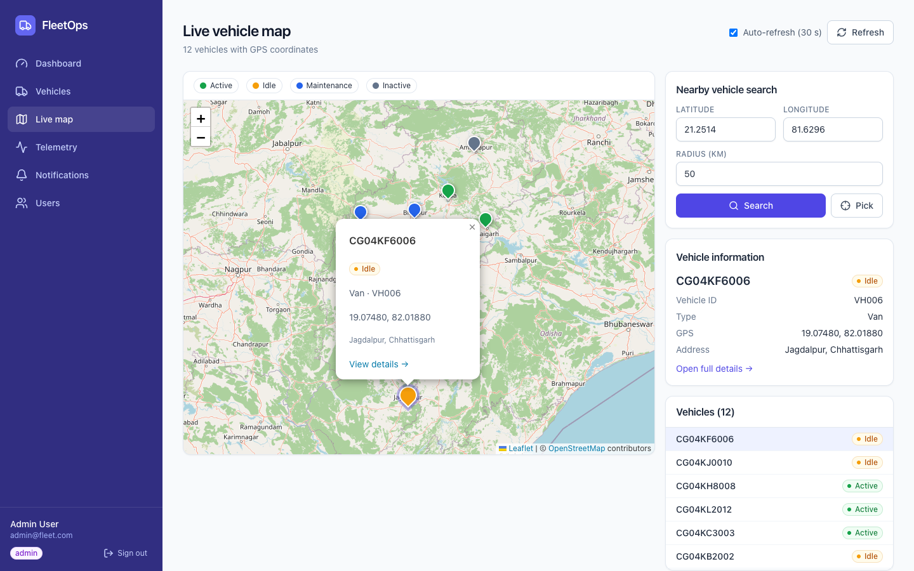
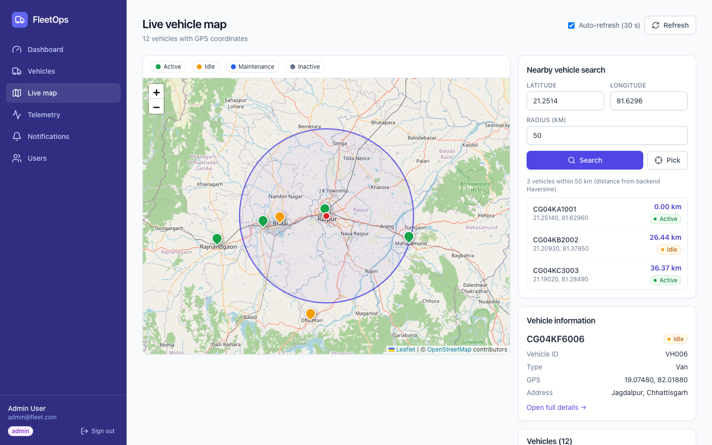
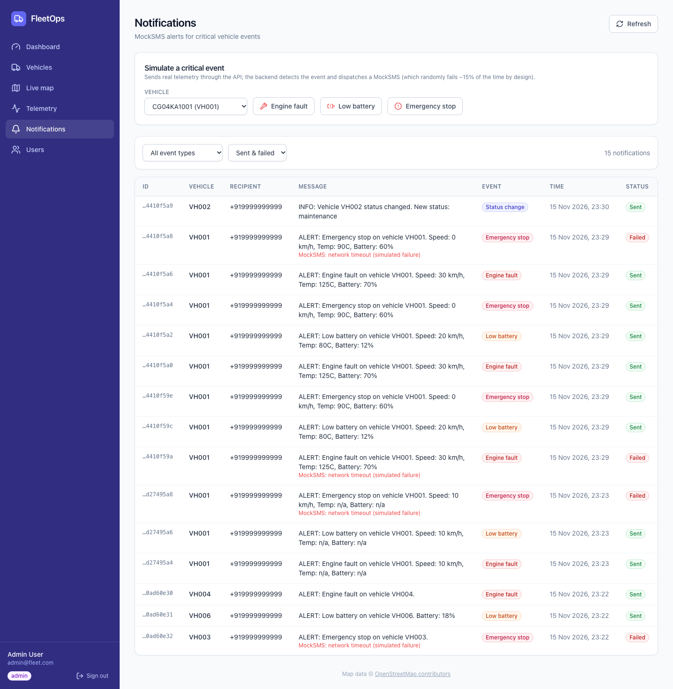
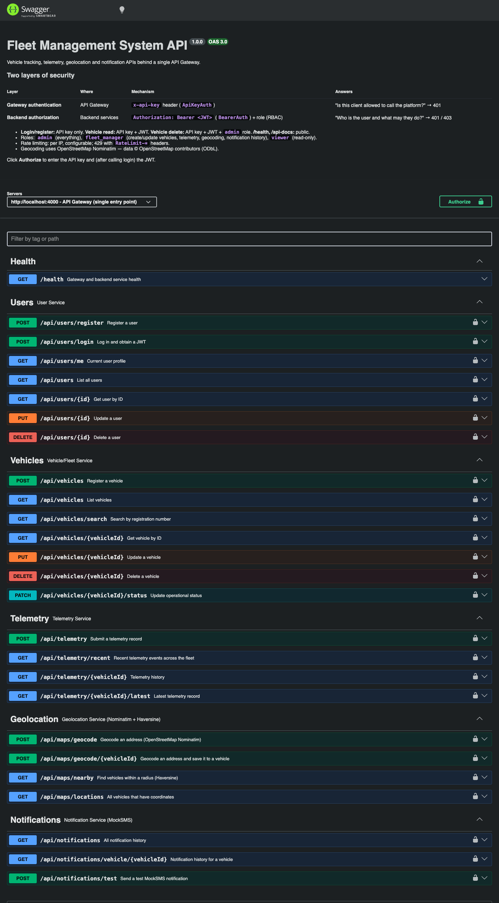
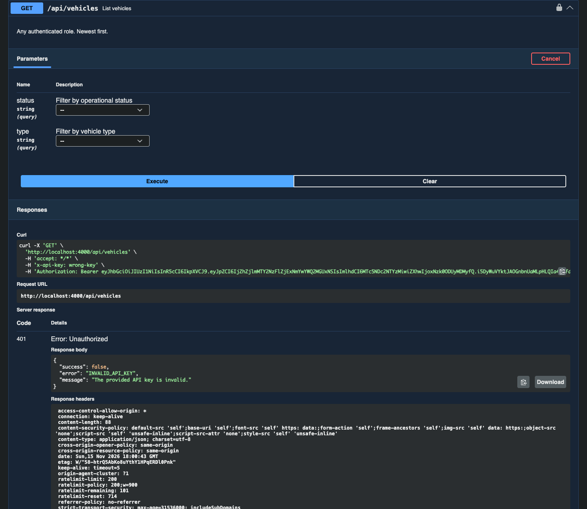
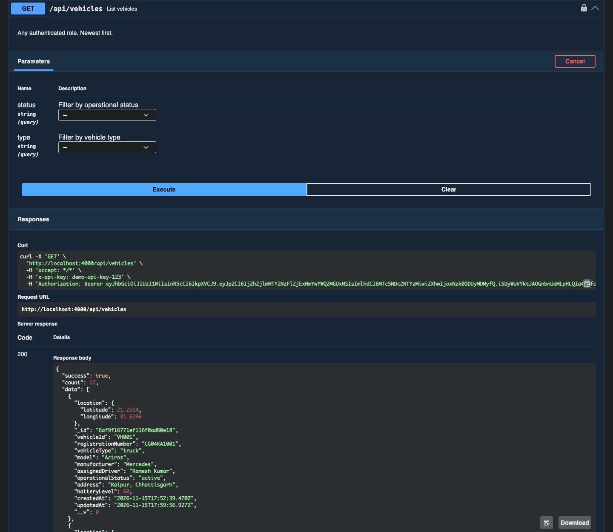
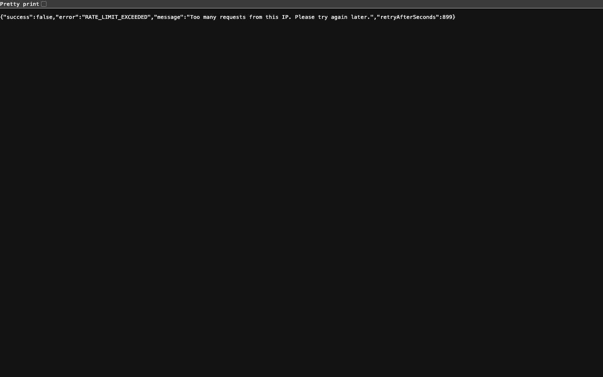

# Documentation

| Document | Contents |
|---|---|
| [API_REFERENCE.md](API_REFERENCE.md) | Every endpoint: auth, roles, parameters, request/response models, examples, error codes, schemas (generated) |
| [openapi.json](openapi.json) | The OpenAPI 3.0 document (also served live at `http://localhost:4000/api-docs.json`; Swagger UI at `/api-docs`) |
| [ARCHITECTURE.md](ARCHITECTURE.md) | Architecture diagram, services, data model, integrations, security model, trade-offs |
| [SETUP_AND_TESTING.md](SETUP_AND_TESTING.md) | Install, configure, seed, run, test, regenerate docs, deployment status |
| [DEMO_GUIDE.md](DEMO_GUIDE.md) | Step-by-step demonstration of the six required demos |
| [../README.md](../README.md) | Project overview, environment variables, Nominatim policy, MockSMS, gateway, examples, limitations |
| [../.env.example](../.env.example) | Configuration template (no real credentials) |
| [../screenshots/](../screenshots/README.md) | Real screenshots of the required demonstrations |
| [../project-report/](../project-report/) | Project report (PDF + HTML) |

## Where the assignment deliverables are

| Deliverable | Location |
|---|---|
| 1. Swagger/OpenAPI documentation | `gateway/docs/swagger.js` → served at `/api-docs`; exported as `openapi.json`; written form `API_REFERENCE.md` |
| 2. API Gateway code (routing, API key, rate limiting) | `gateway/` |
| 3. Mocha/Chai test suite + instructions | `test/`, `.mocharc.js`, [SETUP_AND_TESTING.md](SETUP_AND_TESTING.md) |
| 4. Deployed link | None – not deployed (runs locally) |
| 5. Screenshots | `screenshots/` (also embedded in the project report) |

## Screenshots at a glance

| Geolocation | Nearby vehicles |
|---|---|
|  |  |

| SMS notifications (sent / failed) | Swagger UI |
|---|---|
|  |  |

| Gateway – invalid API key (401) | Gateway – valid key routed (200) | Gateway – rate limit (429) |
|---|---|---|
|  |  |  |
